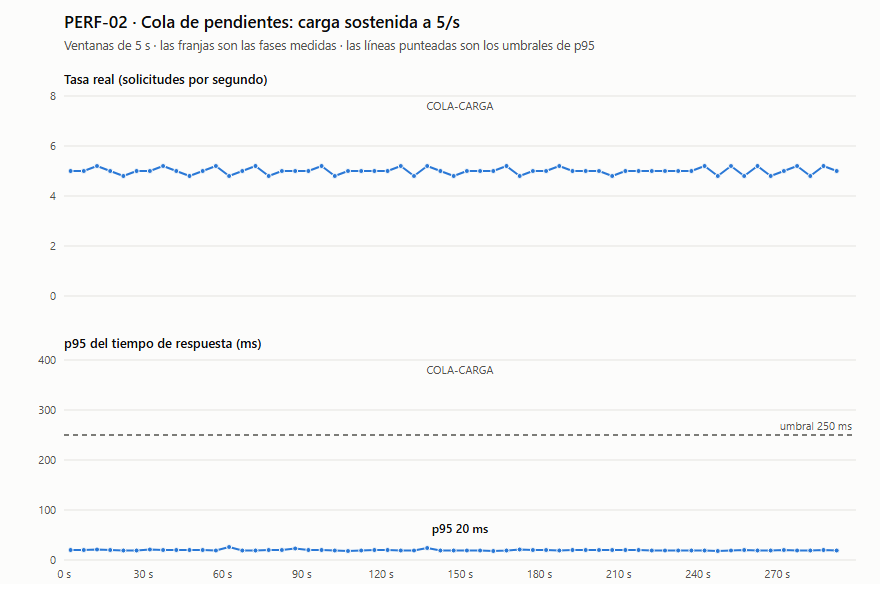

# PERF-02 · Cola de pendientes

| Campo | Valor |
|---|---|
| **Caso / responsable** | PERF-02 · Persona A |
| **Fecha y commit** | 2026-11-26, de 03:14:26 a 03:19:26 (America/Lima) · código medido = `47a8c63`. El `commit.txt` de la corrida registra `9372386` porque la preparación y el plan se commitearon justo después. |
| **Entorno** | Local, Docker Desktop 29.8.1 (16 CPU, 15,2 GB) en AMD Ryzen 7 9700X con 31 GB de RAM. `compose.f02.yaml` con Gateway, Gestión, Operación, `seguridad-local` y PostgreSQL desechable. Servicios en Java 25. JMeter 5.6.3 sobre Java 21. |
| **Dependencias** | Todas locales. La seguridad es el emisor temporal `seguridad-local` (doble). |
| **Datos** | `PreparacionColaCarga`: 10.000 despachos `PENDIENTE_ASIGNACION` sembrados por la API, uno tras otro, en 47 s. El conteo SQL confirma 10.000. El CSV `paginas-cola.csv` trae los IDs esperados de las páginas 1, 50 y 100. |
| **Entrada** | `GET /api/v1/despachos/pendientes?pagina={1,50,100}&tamanoPagina=100` por Gateway, con el JWT del gestor obtenido fuera de la medición. |
| **Tasa objetivo / lograda / duración** | 5/s / **5,003/s** / 300 s, más 60 s de calentamiento excluidos. 10 hilos. |
| **Muestras / p50 / p95 / p99 / máx.** | 1.500 / 17 ms / **20 ms** / 22 ms / 31 ms. 500 muestras por página. |
| **Errores** | 0 (ningún `429`, `5xx`, otro `4xx`, error de red ni tiempo agotado). |
| **Validación de negocio** | Las 1.500 respuestas tenían `totalElementos=10000`, `totalPaginas=100`, 100 filas sin duplicados y los IDs esperados de su página en orden. Control negativo: con las páginas del CSV cruzadas, todas las muestras fallan con `IDS_INCORRECTOS`. |
| **CPU y RAM** (media / máx.) | Gestión 2,3 / 24,4 % CPU, hasta 689 MiB · Gateway 2,2 / 11,8 %, 593 MiB · PostgreSQL 7,6 / 10,2 %, 324 MiB · Operación 0,2 / 0,4 %, 440 MiB · `seguridad-local` 0,3 / 3,7 %, 96 MiB. |
| **Observaciones** | El p95 queda muy por debajo del umbral. A esta tasa la prueba demuestra que se cumple RN-05 con 10.000 registros, pero no busca el límite del servicio; eso sería una prueba de estrés, fuera de alcance. |
| **Resultado** | **Aprobado**: p95 de 20 ms < 250 ms, tasa ≥ 95 %, 0 % de errores y el 100 % de las validaciones de negocio correctas. |
| **Evidencia** | Plan [`PERF-02.jmx`](../rendimiento/PERF-02.jmx) · preparación [`PreparacionColaCarga.java`](../integracion-java/src/test/java/com/modulodespacho/pruebas/integracion/f02/PreparacionColaCarga.java) · [resumen](evidencia/PERF-02-resumen.json) · [gráfica](graficas/PERF-02.svg) ([PNG](graficas/PERF-02.png)). El JTL y el informe HTML están en `pruebas/rendimiento/resultados/PERF-02-20261126-031324/` (fuera de Git). |

