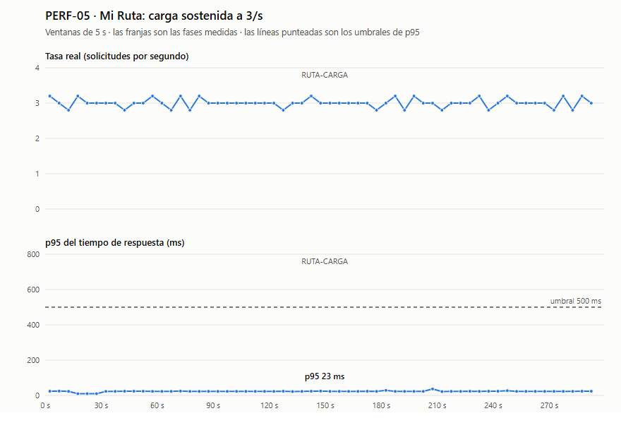

# PERF-05 · Mi Ruta, carga sostenida

| Campo | Valor |
|---|---|
| **Caso / responsable** | PERF-05 · Persona A |
| **Fecha y commit** | 2026-11-26, de 02:44:57 a 02:49:56 (America/Lima) · código medido = `9372386`. El `commit.txt` de la corrida registra `628e231` porque los perfiles de carga, la preparación y el plan se commitearon justo después, sin cambios. |
| **Entorno** | Local, Docker Desktop 29.8.1 (16 CPU, 15,2 GB) en AMD Ryzen 7 9700X con 31 GB de RAM. `compose.f02.yaml` con Gateway, Gestión, Operación, `seguridad-local` y PostgreSQL desechable. Servicios en Java 25. JMeter 5.6.3 sobre Java 21. |
| **Dependencias** | Todas locales. La seguridad es el emisor temporal `seguridad-local`, con los perfiles `repartidor-carga-01` a `-30` agregados para esta prueba. |
| **Datos** | `PreparacionRutasCarga`: 30 repartidores vinculados, cada uno con una jornada activa y 10 despachos. Antes de medir se esperó a que Mi Ruta coincidiera con la ruta de Gestión en las 30. El CSV `rutas-carga.csv` trae la jornada y los `idDespacho:secuencia` de cada identidad. |
| **Entrada** | `GET /api/v1/repartidor/mi-ruta` por Gateway, rotando las 30 sesiones. Las sesiones se obtienen fuera de la medición. |
| **Tasa objetivo / lograda / duración** | 3/s / **3,003/s** / 300 s, más 60 s de calentamiento excluidos. 30 hilos, con turnos globales regulares. |
| **Muestras / p50 / p95 / p99 / máx.** | 899 / 22 ms / **23 ms** / 24 ms / 37 ms. |
| **Errores** | 0. |
| **Validación de negocio** | Las 899 respuestas traían la jornada propia de la identidad y exactamente sus 10 despachos con la secuencia correcta. Control negativo: con las rutas del CSV cruzadas entre identidades, todas las muestras fallan con `JORNADA_INCORRECTA RUTA_INCORRECTA`. |
| **CPU y RAM** (media / máx.) | Gateway 1,0 / 5,7 % CPU, hasta 474 MiB · Operación 0,9 / 2,6 %, 555 MiB · PostgreSQL 2,0 / 4,1 %, 328 MiB · Gestión 0,3 / 0,8 %, 676 MiB · `seguridad-local` 0,3 / 9,1 %, 106 MiB. El pico de `seguridad-local` corresponde a la emisión de sesiones, fuera de la medición. |
| **Observaciones** | La validación corta mostró que `Constant Throughput Timer` (un grupo por fase) y `Precise Throughput Timer` producían ráfagas al iniciar cada fase. Antes de la corrida formal se reemplazaron por un único grupo con turnos globales. Ver el README de rendimiento. |
| **Resultado** | **Aprobado**: p95 de 23 ms < 500 ms, tasa ≥ 95 %, 0 % de errores y ninguna respuesta con datos ajenos. |
| **Evidencia** | Plan [`PERF-05.jmx`](../rendimiento/PERF-05.jmx) · preparación [`PreparacionRutasCarga.java`](../integracion-java/src/test/java/com/modulodespacho/pruebas/integracion/f02/PreparacionRutasCarga.java) · [resumen](evidencia/PERF-05-resumen.json) · [gráfica](graficas/PERF-05.svg) ([PNG](graficas/PERF-05.png)). El JTL y el informe HTML están en `pruebas/rendimiento/resultados/PERF-05-20261126-024354/` (fuera de Git). |

