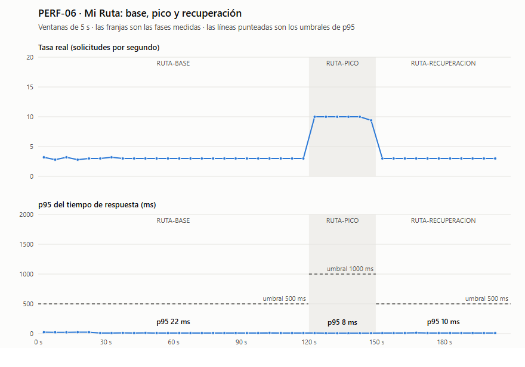

# PERF-06 · Mi Ruta, pico y recuperación

| Campo | Valor |
|---|---|
| **Caso / responsable** | PERF-06 · Persona A |
| **Fecha y commit** | 2026-11-26, de 02:51:15 a 02:54:45 (America/Lima) · código medido = `9372386`. El `commit.txt` de la corrida registra `628e231`; ver PERF-05. |
| **Entorno** | Igual que PERF-05, sin reiniciar entre corridas. |
| **Dependencias** | Igual que PERF-05. |
| **Datos** | Las mismas 30 rutas, sesiones, endpoint y aserciones de PERF-05. |
| **Entrada** | `GET /api/v1/repartidor/mi-ruta` por Gateway. |
| **Tasa objetivo / lograda / duración** | Ver la tabla por fase. 60 s de calentamiento excluidos; las tres fases son consecutivas en el mismo grupo de 30 hilos. |
| **Errores** | 0 en todas las fases. |
| **Validación de negocio** | Las 837 respuestas medidas traían la ruta correcta de su identidad. |
| **CPU y RAM** (media / máx.) | Operación 1,7 / 7,5 % CPU, hasta 625 MiB (el máximo coincide con el pico) · PostgreSQL 2,3 / 4,5 %, 320 MiB · Gateway 1,2 / 3,0 %, 478 MiB · Gestión 0,4 / 1,4 %, 679 MiB · `seguridad-local` 0,2 / 2,3 %, 107 MiB. |
| **Resultado** | **Aprobado** en cada fase. |
| **Evidencia** | Plan [`PERF-06.jmx`](../rendimiento/PERF-06.jmx) · [resumen](evidencia/PERF-06-resumen.json) · [gráfica](graficas/PERF-06.svg) ([PNG](graficas/PERF-06.png)). El JTL y el informe HTML están en `pruebas/rendimiento/resultados/PERF-06-20261126-025013/` (fuera de Git). |

## p95 por fase

| Fase | Tasa objetivo | Tasa lograda | Muestras | p50 | p95 | p99 | Umbral p95 | Resultado |
|---|---|---|---|---|---|---|---|---|
| `RUTA-BASE` (120 s) | 3/s | 3,008/s | 360 | 8 ms | **22 ms** | 23 ms | < 500 ms | Aprobado |
| `RUTA-PICO` (30 s) | 10/s | 10,034/s | 297 | 7 ms | **8 ms** | 9 ms | < 1000 ms | Aprobado |
| `RUTA-RECUPERACION` (60 s) | 3/s | 3,017/s | 180 | 8 ms | 10 ms | 16 ms | — | Aprobado |
| Últimos 30 s de recuperación | 3/s | 3,0/s | 90 | 8 ms | **10 ms** | 17 ms | < 500 ms | Aprobado |

La tasa por segundo se mantuvo entre 2 y 4/s en la base y la recuperación, y entre 9 y 11/s en el pico, sin ráfagas. El sistema absorbió el pico sin degradarse: el p95 del pico fue incluso menor que el de la base, cuyas primeras ventanas fueron algo más lentas. Por eso no hay una recuperación que medir más allá de confirmar que el tiempo sigue bajo el umbral.

**Observación.** El pico de 10/s es una carga pequeña para este entorno. El caso demuestra que se cumplen las metas y que no se mezclan identidades bajo un aumento brusco, pero no dónde empieza la degradación.

